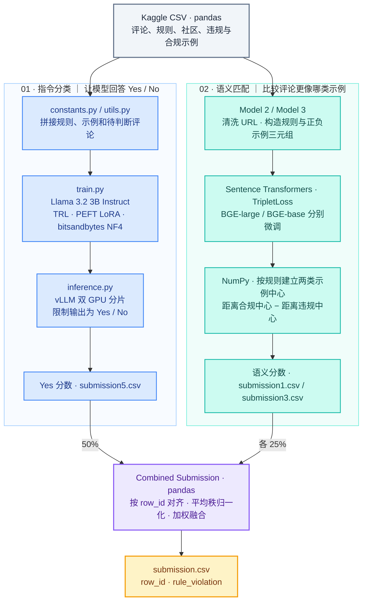

# Jigsaw · 社区规则违规识别

**2025 Kaggle Jigsaw – Agile Community Rules Classification**  
原 README 记录：**铜牌，174 / 2,437 队（约前 7.14%）**。

给定一条 Reddit 评论、一条社区规则，以及违规和合规示例，系统为这条评论打出违规分数。项目用了两种判断方式：让语言模型直接回答「是否违规」，以及比较评论在语义上更接近哪一类示例。最终把三个模型的分数换成排名，再加权合并。

## 项目逻辑架构

两条路线都在主 Notebook 中。蓝色模块判断规则与评论的关系，绿色模块比较评论与两类示例的距离，紫色部分汇总结果。

图里的 Python 脚本由主 Notebook 的 `%%writefile` 单元格生成。训练、推理与融合入口都可在同一文件找到。[主 Notebook](fork-of-mocode.ipynb)

## 模块、技术栈与进展

| 模块 | 功能 | 技术栈 | 当前进展与产物 |
| :--- | :--- | :--- | :--- |
| 指令分类 · 数据准备 | 把社区、规则、正反示例和评论放进同一条提示词。训练时结合带标签训练行与从测试表自带示例构造的样本 | pandas、NumPy、Hugging Face Datasets | `constants.py`、`utils.py` 生成逻辑已收录。测试表提供的违规、合规示例用于构造标签，待预测评论本身的标签未知 |
| 指令分类 · 训练 | 在 Llama 3.2 3B Instruct 上训练少量适配参数，让模型学习输出 Yes 或 No | PyTorch、Transformers、TRL SFTTrainer、PEFT、bitsandbytes | `train.py` 写入 LoRA 权重到 `/kaggle/working/pseudo_lora`。另有 Accelerate / DeepSpeed ZeRO-2 配置 |
| 指令分类 · 推理 | 将测试行分给两张 GPU，从受约束的单 token 输出中读取 Yes 分数 | vLLM、logits-processor-zoo、Python multiprocessing | `inference.py` 设计输出 `submission5.csv`。该分数用于后续排名 |
| 语义匹配 · 文本与训练 | 规范 URL，再把规则、合规示例、违规示例组成三元组。训练时拉近规则和合规示例的向量 | Python、Sentence Transformers、Hugging Face Datasets、TripletLoss | Model 2 为 BGE-large-en-v1.5，Model 3 为 BGE-base-en-v1.5。训练前会检查本地适配模型是否已存在 |
| 语义匹配 · 距离打分 | 为每条规则建立一个违规示例中心和一个合规示例中心，比较评论到两者的距离 | Sentence Transformers、NumPy 欧氏距离 | 已实现逐规则打分。离违规中心越近、离合规中心越远，分数越高。两个模型分别写入 `submission1.csv`、`submission3.csv` |
| 提交融合 | 按 `row_id` 排序并检查三份结果是否对齐，再把各自分数换成可比较的排名 | pandas、平均秩归一化 | 融合单元格写入 `/kaggle/working/submission.csv` |
| 独立参考基线 | 单独跑 BGE 三元组训练与距离打分 | Sentence Transformers、NumPy | 独立 Notebook 的文件名含 FAISS。其分数文件没有被主 Notebook 的融合单元格额外读取。[基线 Notebook](jigsaw-speed-run-10-min-triplet-and-faiss-af5e7a.ipynb) |

## 关键参数

| 环节 | 代码配置 | 含义 |
| :--- | :--- | :--- |
| Llama 训练样本 | `use_train=True`，`frac=0.05`，seed **0** | 使用训练表，并按规则从测试表抽取约 **5%** 的行，利用每行自带的两条违规和两条合规示例构造样本，合并后去重 |
| Llama 量化 | **4-bit NF4** | 当前非 GPTQ 路径用 bitsandbytes 以较低精度加载基础权重 |
| LoRA | rank **64**，alpha **128**，dropout **0.1** | 更新注意力和前馈网络中的 **7 个**投影层 |
| Llama 训练 | **1 epoch**，每设备 batch **4**，梯度累积 **4**，学习率 **1e-4**，warmup 比例 **0.03** | 控制训练轮数、显存占用与参数更新速度 |
| Llama 推理 | **2 个 GPU 进程**，上下文上限 **2,048 tokens**，生成 **1 token**，`logprobs=2`，显存利用率目标 **0.98** | 两张卡各处理一部分评论。取 Yes 对应的分数进入融合 |
| BGE 训练 | **1 epoch**，batch **32**，学习率 **2e-5**，Triplet margin **0.25** | 两个 BGE 分支的实际训练调用使用同一组参数 |
| BGE 三元组 | 抽样比例 **1.0**，增强系数 **2**，seed **42** | 使用测试表提供的示例构造三元组。规则是锚点，合规示例是三元组正样本，违规示例是负样本 |
| BGE 编码与打分 | 编码 batch **64**，向量归一化，每规则 **2 个中心** | 两类示例各取平均向量并归一化，再算评论到两个中心的距离差 |
| 三模型融合 | **0.50 / 0.25 / 0.25** | Llama 占一半，BGE-large 和 BGE-base 各占四分之一 |

融合时先计算 `平均排名 / (总行数 + 1)`，分数相同的样本共享平均排名。最后做加权求和。不同模型原始分数的量纲可以不同，提交值表达相对违规顺序。

## 量化结果与验证状态

| 项目 | 数值或状态 | 口径 |
| :--- | :--- | :--- |
| 历史竞赛记录 | **铜牌，174 / 2,437 队** | 沿用原 README，仓库未附对应提交记录 |
| 名次比例 | **约前 7.14%** | 由 174 ÷ 2,437 计算 |
| 提交流程 | **2 条路线、3 路模型分数、1 份融合 CSV** | 由主 Notebook 的模型段落和最终融合单元格核对 |
| 单模型与融合 AUC | 未找到保存的分数 | 当前 Notebook 没有保留可引用的验证或榜单 AUC，无法从代码单独量化融合收益 |
| 推理速度与显存实测 | 未找到保存的测量记录 | GPU 数与显存利用率目标是配置值 |

## 运行入口与依赖

1. 在 Kaggle 挂载竞赛数据、LLM 和 BGE 权重，以及 Notebook 引用的离线 wheel 数据集。LLM 路线还引用 KaggleHub 的 `wasupandceacar/deterministic`。
2. 执行主 Notebook 中的脚本生成单元格，再运行 Llama 的训练与推理脚本。运行训练时可参考生成的 `accelerate_config.yaml`。从仓库复跑需显式启动这些脚本。
3. 运行 Model 2 和 Model 3 段落，确保三份中间 CSV 都在融合单元格可读取的位置。运行 Combined Submission 导出结果。

主 Notebook 的离线安装配置包括 TRL **0.21.0**、bitsandbytes **0.46.1**、vLLM **0.10.0** 和 DeepSpeed **0.17.4**。这些版本对应仓库中的 Kaggle 配置。本次文档更新按代码核对流程和参数，未重跑 GPU 训练。

LLM 路线的外部参考实现见 [Kaggle Llama 3.2 3B Instruct 伪标签训练基线](https://www.kaggle.com/code/wasupandceacar/jigsaw-pseudo-training-llama-3-2-3b-instruct)。
